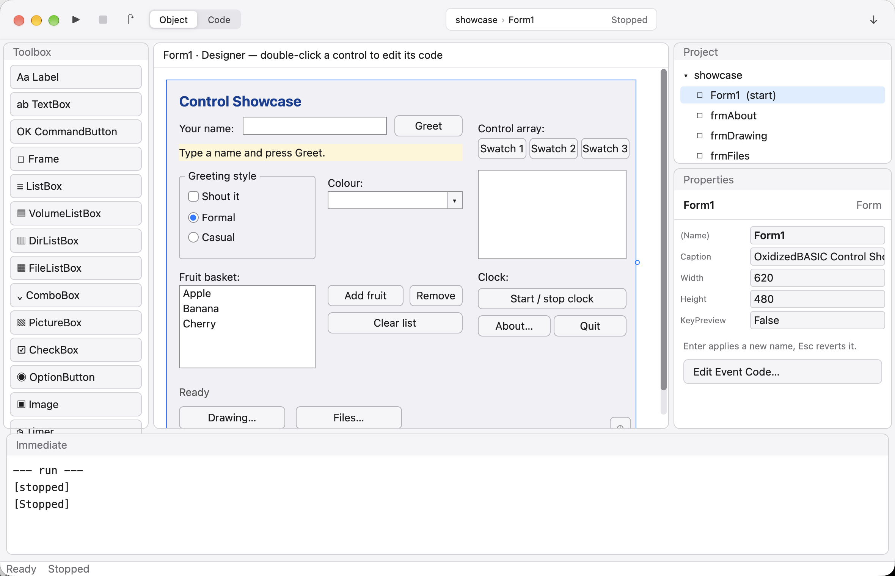

# OxidizedBASIC (`oxbasic`)

An open-source, ultra-fast, memory-safe classic BASIC programming suite
written entirely in Rust, per `oxidizedbasic_technical_specification.md`.
Full syntax and semantic compatibility with Visual Basic 6.0 / classic VBA
is the goal; GPUI-based GUI rendering and the visual IDE follow in later
phases. For every keyword the language accepts, see
[`docs/keywords.md`](docs/keywords.md).



*The IDE with the showcase project: the designer (Form1 with its controls),
the toolbox on the left, the project and properties on the right, and the
Immediate pane below.*

## Status — Phases 1, 2 & 3 complete; Phase 4 (JIT and packaging) started

### Phase 1: syntax parser & core runtime
- **Parser** (`oxbasic_parser`): `pest` grammar for the classic VB6/VBA
  statement surface — `If/Then/ElseIf/Else` (block + single-line),
  `Select Case` (values, `To` ranges, `Is` comparators, `Case Else`),
  `For…Next [Step]`, `For Each…In`, `Do While/Until…Loop` (pre- and
  post-test), `While…Wend`, `Sub`/`Function` with `ByVal`/`ByRef`/
  `Optional`/`ParamArray`, `Dim`/`Static`/`Const`, arrays, labels,
  `GoTo`, `GoSub`/`Return`, `On Error GoTo <label>|0`, `On Error Resume Next`,
  `Resume [Next|label]`, `Exit {Sub,Function,For,Do}`, `End`, `Stop`,
  `Option Explicit`, `Option Base 0|1` (arrays index from 1 under base 1),
  `Option Compare Text|Binary`, `Let`, `Erase`, `ReDim [Preserve]`, the `Mid`
  statement, `With…End With` (a leading `.Member` reads, writes or calls on the
  With object), `Type…End Type` (records, including fields that are arrays),
  `Enum…End Enum` (named constants), `DefInt`/`DefLng`/`DefStr`/… (implicit
  types of undeclared names by first letter), `Print`/`Debug.Print`
  with `;`/`,` separators, colon-separated statements, `&H`/`&O` literals,
  `'` and `Rem` comments, and full VB operator precedence.
- **Runtime** (`oxbasic_runtime`): tree-walking interpreter with a
  VB-style `Variant` tagged enum, `Rc<RefCell<…>>`-shared scopes so
  `ByRef` parameters mutate callers, multi-dimension fixed arrays plus
  auto-growing dynamic arrays, trappable `On Error` handling with the
  `Err` object, a ~70-function standard library, and `evaluate_sub` —
  the UI event bridge.

### Phase 2: GPUI element binding engine
- **Form model** (`oxbasic_ui`): render-agnostic classic VB forms and
  controls (`Form`, `CommandButton`, `Label`, `TextBox`, `Frame`,
  `ListBox`, `ComboBox`, `PictureBox`, `Timer`) with VB layout
  coordinates, `.oxform` JSON layout files, and the event dispatcher
  that routes UI events to BASIC subs (`Command1_Click`, `Form_Load`,
  `Timer1_Timer`, …).
- **GPUI backend** (`oxbasic_ui`, `gpui` feature): maps the form to a
  real GPU-accelerated GPUI window (Metal on macOS) — absolutely
  positioned controls with hover/active button states, focusable
  text boxes with keyboard input firing `Change`, clickable list box
  rows, and async background timers firing `Timer` events — all
  dispatched into the live BASIC interpreter.
- **CLI**: `oxbasic gui <form.oxform> <program.bas>` opens the window,
  runs module-level code, fires `Form_Load`, and serves events until
  the window closes.

### Phase 3: the visual IDE
- **`oxbasic ide [file.bas] [form.oxform]`** launches a GPUI IDE window:
  - **Code window** (View Code / F7, or double-click a control): opens
    the module in its own window. Its header has an object select box
    (`(General)`, `Form`, every control) and, beside it, the event select
    box for that object (bold = has code). Picking an event jumps to its
    handler, inserting a `Private Sub Object_Event(...)` placeholder if it
    doesn't exist. Double-clicking a control opens its default event.
  - **Code editor**: select with Shift + arrows (⌥ by word, ⌘ to the
    line or text ends) or the mouse (drag, Shift-click, double-click a
    word, triple-click a line); ⌘A selects all. Typing, Backspace and
    Delete replace the selection. **Cut / Copy / Paste** (⌘X ⌘C ⌘V) use
    the system clipboard, and **Undo / Redo** (⌘Z ⇧⌘Z) step through the
    edits (a run of typing is one step; an inserted event placeholder is
    one too). All are also on the new Edit menu.
  - **Code folding**: a `▾` beside a block's first line folds it (`Sub`,
    `Function`, `For`, `Do`, `While`, block `If`, `Select Case`, `With`,
    `Type`, `Enum`); `▸` opens it again. The header and the closing line stay
    visible, and moving the caret into a folded block opens it. Folding only
    changes what is drawn, so line numbers and breakpoints are unaffected.
  - **Syntax diagnostics**: a line the parser cannot read is underlined in
    red from the bad text to the end of the line. With the caret on that line,
    the status line shows the message and its line number. Only the first
    error is marked. A word alone on a line that names nothing the module can
    run (a misspelled `Else` such as `Elsee`, or a call to a sub that does not
    exist) is marked the same way, as an unknown name. A misspelled member of
    a control (`lstFruit.RemooveItem`) is marked when the control's kind has
    its member list written down: TextBox, CheckBox, OptionButton, ListBox,
    ComboBox, PictureBox, Image, Timer, the scrollbars, ProgressBar, Slider,
    Shape, Line, TabControl, the file-browser lists and DataGrid. The check
    covers a property written with `=` as well as a method call. The lists
    are checked against the runtime by a test, so they cannot drift from it.
    A name inside an expression is checked too: `x = Helpr(2)` is marked,
    while declared variables, procedures (in any module of the project),
    controls, built-ins, built-in constants (`vbCrLf`) and `Err` are known.
  - **Visual form designer**: the form canvas renders the `.oxform`
    layout; click to select controls, **drag to move** them and **drag
    the eight selection handles** to resize them (like VB6), and add
    controls from the toolbox. With the form itself selected, handles
    on its bottom and right edges resize the form. The
    designer shows no code; Timers appear as ◷ icons.
  - **Controls beyond the VB6 basics**: `HScrollBar` and `VScrollBar`
    (a live thumb; dragging it sets `Value` and runs its `Change`
    handler), `Shape` and `Line` (drawn through the PictureBox canvas),
    and the file browser: `VolumeListBox` (the mounted volumes, in place
    of VB6's DriveListBox), `DirListBox` (the sub-folders of `Path`) and
    `FileListBox` (the files matching `Pattern`, with `FileName`),
    `Slider` (a draggable range, with `Orientation`), `ProgressBar` (a
    range the program fills) and `TabControl` (tabs with pages of
    controls). See `docs/controls.md`.
  - **Menus**: a form's menu bar (File and so on, with shortcuts). Items
    marked as application-menu items (About, Quit) sit under the menu named
    after the app, as on a Mac. While the form's window is in front its menu
    is the menu bar, and choosing an item runs its `name_Click` handler. Edit,
    View and Run stay in the IDE's menu bar when the File menu refreshes (Open
    Recent changes, saves). The IDE and a packaged app both have About and Quit
    under the app menu.
  - **Property inspector**: `(Name)` (renames the control and its
    `Name_Event` handlers and references in code), Caption, Text, Items,
    Left/Top/Width/Height, Timer interval; the form's own properties show
    when nothing is selected. Names are validated as you type.

  - **Debugger**: Run / Step / Stop toolbar controls. The program runs
    on a background thread with a debug hook — **breakpoints by source
    line** (the parser now emits line markers), **step-over** semantics,
    pause/continue, and abort. While paused, the editor highlights the
    current line and the **Watch pane** shows every local and global
    variable with its value.
  - **Output pane** streams `Print`/`MsgBox` output live from the
    running program.
- **Runtime debugger API**: `Interpreter::set_debug_hook` /
    `set_breakpoints` with `PausedInfo` (line, procedure, depth, locals,
    globals) and `DebugAction` (Continue / StepOver / Abort) — usable
    headless (see the debugger integration tests).

## Usage

```sh
cargo build -p oxbasic_ide
./target/debug/oxbasic ide examples/clickme.bas examples/clickme.oxform  # the IDE
./target/debug/oxbasic run examples/demo.bas                    # console program
./target/debug/oxbasic gui examples/clickme.oxform \
                      examples/clickme.bas                      # GPUI form app
./target/debug/oxbasic repl                                     # immediate window
cargo test --workspace                                          # ~400 tests
```

`.oxform` layout files are JSON:

```json
{
  "name": "Form1", "caption": "Demo", "width": 340, "height": 240,
  "controls": [
    { "name": "Command1", "kind": "CommandButton",
      "rect": { "left": 16, "top": 48, "width": 100, "height": 30 },
      "caption": "Click Me" }
  ]
}
```

Controls map to GPUI elements per spec §5 (see `oxbasic_ui`'s mapping
table); events dispatch to `<ControlName>_<Event>` subs in the BASIC
program. `scripts/gui_smoke.sh` verifies the window opens, `Form_Load`
fires, and the async timer drives `Timer1_Timer`.

## Workspace layout

```
crates/
├── oxbasic_ast/         # AST data structures & symbol definitions
├── oxbasic_parser/      # Grammar (pest), lexer, parser
├── oxbasic_runtime/     # Interpreter, Variant system, stdlib
├── oxbasic_ui/          # Form model + event dispatcher + GPUI backend
└── oxbasic_ide/         # `oxbasic` CLI binary (ide / gui / run / repl)
examples/                # hello.bas, demo.bas, fib.bas, clickme.bas + .oxform;
                         # showcase/ (every control) and fractal/ (Mandelbrot, PSet)
scripts/                 # gui_smoke.sh, ide_smoke.sh — launch smoke tests
```

## Standard library (builtins)

Math: `Abs Sqr Int Fix Sgn Sin Cos Tan Atn Exp Log Rnd Randomize Hex Oct`
Strings: `Len Left Right Mid UCase LCase Trim LTrim RTrim InStr InStrRev
Replace Space String StrReverse Chr Asc Str Val Format Split Join StrComp IIf`
Conversions: `CInt CLng CDbl CSng CCur CVar CBool CStr CDate IsNumeric
IsArray IsEmpty IsNull IsDate VarType TypeName`
Arrays: `Array UBound LBound`
Dates: `Now Date Time Year Month Day Hour Minute Second Weekday DateSerial
TimeSerial DateAdd DateValue` (VB serial dates, day 0 = 1899-12-30)
Console: `Print`, `Debug.Print`, `MsgBox`, `InputBox`, `Beep`, `DoEvents` (in the IDE it
shows what a long handler has drawn so far, and lets Stop end it)
File dialogs: `OpenFileDialog(filter)` and `SaveFileDialog(filter)` show the
native macOS picker and return the chosen path, or `""` when cancelled or when
the file doesn't match `filter` (`*.bas;*.oxproj`, the same rule as
`FileListBox.Pattern`). They work in the IDE and in packaged apps.
Constants: `vbCrLf vbCr vbLf vbNewLine vbTab vbNullString vbOKOnly …`

## Building the GUI on macOS

The `gpui` feature needs Xcode's Metal toolchain once:

```sh
xcodebuild -downloadComponent MetalToolchain
```
## macOS application bundle

`scripts/make_app.sh` builds the release IDE and packages it as
`dist/OxidizedBASIC.app`, a double-clickable application with the app icon:

```sh
./scripts/make_app.sh            # build dist/OxidizedBASIC.app
./scripts/make_app.sh --open     # build, then open it
```

Run it again whenever the IDE changes. The bundle takes its version from
`Cargo.toml` and its build from the git commit. The icon comes from
`packaging/icons` (the Icon Package): the `.iconset` is the source, and the
`.icns` is rebuilt from it with `iconutil` when the iconset is newer.

The app is ad-hoc signed, so it runs on this Mac. Giving it to another Mac
needs a Developer ID signature and notarisation, which the script does not do.

A packaged project (`oxbasic play`) shows each form in its own window, with the
form's menu bar as the application's while that window is in front. The form's
window takes the focus when it opens and when it becomes active, because a menu
item is enabled only while the form holds the focus. Without that, every item
of the form's menu shows disabled.


## Known limitations

- **Control properties from BASIC** work when the program runs from the
  IDE (`oxbasic gui` and `oxbasic run` don't bind a form yet, so there
  these still fail). The program reads and writes the live form, and sees
  what the user typed, picked or clicked:
  - every control: `Caption`, `Text`, `Visible`, `Enabled`,
    `Left/Top/Width/Height`, `BackColor`, `ForeColor`, `Font.Name`,
    `Font.Size`, `Font.Bold/Italic/Underline/Strikethrough` (also
    `FontBold` etc.), `TabIndex`, `TabStop`, `ToolTipText`,
    `MousePointer`, `Container` (`Set X.Container = Frame1`), `SetFocus`,
    `Move`, `ZOrder`; the form: `Caption`, `Width`, `Height`,
    `KeyPreview` through `Me` or its name;
  - `CheckBox.Value` (`vbUnchecked`/`vbChecked`/`vbGrayed`) and
    `OptionButton.Value` (True clears the other option buttons in the
    same Frame, PictureBox or form);
  - text boxes: `SelStart`, `SelLength`, `SelText`, `Locked`,
    `MaxLength`, and (set in the designer) `MultiLine` and `ScrollBars`;
  - list and combo boxes: `AddItem [, index]`, `RemoveItem`, `Clear`,
    `List(i)`, `ListCount`, `ListIndex`, and for a ListBox
    `Selected(i)`, `SelCount` and (set in the designer) `MultiSelect`;
  - a PictureBox's `Picture = LoadPicture("file.png")`, `AutoSize`, and
    its drawing statements `Line`, `PSet`, `Circle` (with `Step`, boxes,
    arcs, `CurrentX`/`CurrentY`) and `Cls`; the Image control's `Picture`
    and `Stretch`; `MouseIcon` for a custom pointer;
  - timers: `Interval` and `Enabled` take effect on the running timer;
  - control arrays: give controls the same name and distinct `Index`
    values (Properties window); the program says `Cmd(2).Caption = "x"`,
    adds and removes elements with `Load Cmd(3)` / `Unload Cmd(3)`, and
    handlers take `Index As Integer`;
  - colours are VB `Long`s: `RGB(r, g, b)`, `vbRed`..., and the system
    colours (`vbButtonFace`, `vbWindowBackground`...). Errors are VB's:
    438 unsupported member, 380 bad value, 381 bad list index, 382
    read-only, 340/343/360/362 control arrays, 53 picture not found.
  See `docs/controls.md` for every member.
- Run opens the form in its own OS window. Every event the code window
  lists reaches the program, in VB's order: mouse (`MouseDown`,
  `MouseMove`, `MouseUp` with button, shift and position; `Click` on
  release; `DblClick`), keys (`KeyDown`, `KeyPress`, `KeyUp`, with
  `KeyAscii`/`KeyCode` changeable and `KeyPreview`), focus (`GotFocus`,
  `LostFocus`, Tab), `Change`, `Scroll`, `DropDown`, `Timer`, and the
  form's `Load`, `Activate`, `Deactivate`, `Resize`, `Paint`,
  `QueryUnload` and `Unload`. Closing the window can be cancelled with
  `Cancel = True`. A property the program sets raises its event as in VB
  (`Text1.Text = "x"` runs `Text1_Change`). See `docs/controls.md`.
- Property-inspector editing and toolbox adding were reworked (per-field
  focus, redraw on add) but have only been checked by build/tests, not
  yet by hand.
- The IDE's editor has no find/replace, word wrap, or multiple carets;
  undo history is per document and is cleared when you switch documents
  or a rename changes the code. The debugger supports breakpoints,
  step-over, step-into (F8), and watch.
- `MsgBox` prints to the console/output pane (a native GPUI dialog is a
  follow-up).
- The file dialog filters after the user picks a file, so the picker shows
  every file; a file the filter rejects comes back as `""`.
- Shapes and Lines are kept within the form. A FileListBox's double click
  raises `DblClick`; the program opens the file it names with `FileName`.
- Menus are edited in the Menu Editor (Properties → Menu Editor…), with
  shortcuts set from modifier toggles and a key box.
- `Resume`/`Resume Next` resume precisely when the handler sits at the
  same block level as the failing statement (the common VB idiom).
- Language gaps: file I/O is not implemented yet. A `Type` cannot hold a field
  of a user-defined `Type` (only built-in field types and arrays of them).

## Roadmap

- Phase 4: Cranelift JIT backend and `.app` packaging. Started: integer `For`
  loops compile to native code with the `jit` feature
  (`cargo build --release -p oxbasic_ide --features oxbasic_runtime/jit`), which
  runs `examples/basica.bas` in 0.01 to 0.02 s instead of 1.26 s; see
  `docs/jit.md`. Still to do: more loop types, calls and arrays, turning the
  feature on in the shipped build, and a signed, notarised `.app`.
